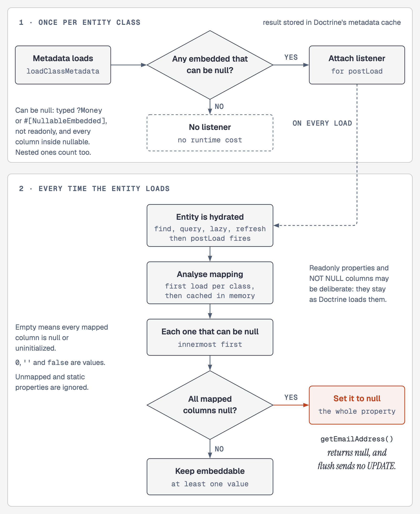

# Nullable Embeddable Bundle

[](https://github.com/hyphaeworks/nullable-embeddable-bundle/actions/workflows/ci.yml)

A nullable embeddable bundle that just works.

Doctrine always creates an [embeddable](https://www.doctrine-project.org/projects/doctrine-orm/en/current/tutorials/embeddables.html)
object on load, even when all its columns are `NULL`. This [Symfony bundle](https://symfony.com/doc/current/bundles.html)
sets such an empty embeddable to `null` instead: install it, type the property as nullable, done.

## Installation

```bash
composer require hyphaeworks/nullable-embeddable-bundle
```

Register the bundle in `config/bundles.php` if Symfony Flex did not do it for you. No configuration is needed.

```php
Hyphaeworks\NullableEmbeddableBundle\NullableEmbeddableBundle::class => ['all' => true],
```

| Package                  | Versions      |
|--------------------------|---------------|
| PHP                      | 8.2 to 8.5    |
| Symfony                  | 6.4, 7.4, 8.x |
| doctrine/orm             | 2.17+, 3.x    |
| doctrine/doctrine-bundle | 2.12+, 3.x    |

## Usage

Give the embedded property a nullable type. That's all:

```php
use Doctrine\ORM\Mapping as ORM;

#[ORM\Embeddable]
final class EmailAddress
{
    public function __construct(
        #[ORM\Column(nullable: true)]
        public ?string $address = null,
    ) {
    }
}

#[ORM\Entity]
class User
{
    #[ORM\Embedded(class: EmailAddress::class)]
    private ?EmailAddress $emailAddress = null;
}
```

An untyped property needs the `#[NullableEmbedded]` attribute instead:

```php
#[ORM\Embedded(class: EmailAddress::class)]
#[NullableEmbedded]
private $emailAddress;
```

This works with attribute and XML mapping, nested embeddables, inherited properties and mapped superclasses.

## How it works



## Rules

- An embeddable is empty when every mapped column in it is `null` or uninitialized.
  Unmapped and static properties are ignored; `0`, `''` and `false` are values.
- Nested embeddables are checked innermost first: an outer embeddable that only holds an empty inner one becomes `null` too.
- A property is only set to `null` when that is possible. These are left exactly as Doctrine loads them,
  because they may be deliberate:
  - a non-nullable embedded property (`EmailAddress $emailAddress`);
  - a `readonly` embedded property, which cannot be changed after Doctrine has set it;
  - an embeddable with a `NOT NULL` column: the database never returns all of its columns as `NULL`,
    so there is nothing to set to `null`. To store `null` in such a property, every column needs `nullable: true`.
- Avoid `readonly` in embeddables if you use `refresh()`: Doctrine itself cannot refresh an entity with a `readonly`
  embedded property or an embeddable with `readonly` properties, with or without this bundle.
- Single-column value objects (an email address, a currency code) are often better served by a
  [custom DBAL type](https://www.doctrine-project.org/projects/doctrine-orm/en/current/cookbook/custom-mapping-types.html).

## Metadata cache

The bundle hooks into entities with nullable embedded properties through Doctrine's class metadata, so the hook
is stored in the metadata cache. Default Symfony setups rebuild that cache on deploy. If yours lives in a persistent
store (Redis, Memcached, a database), clear it after installing or upgrading the bundle and after changing an embedded
property's mapping, or empty embeddables are silently kept:

```bash
bin/console doctrine:cache:clear-metadata
```

## Performance

Entities without a nullable embedded property are not affected. The others cost about 1µs more per loaded entity.

## License

MIT. See [LICENSE](LICENSE).
